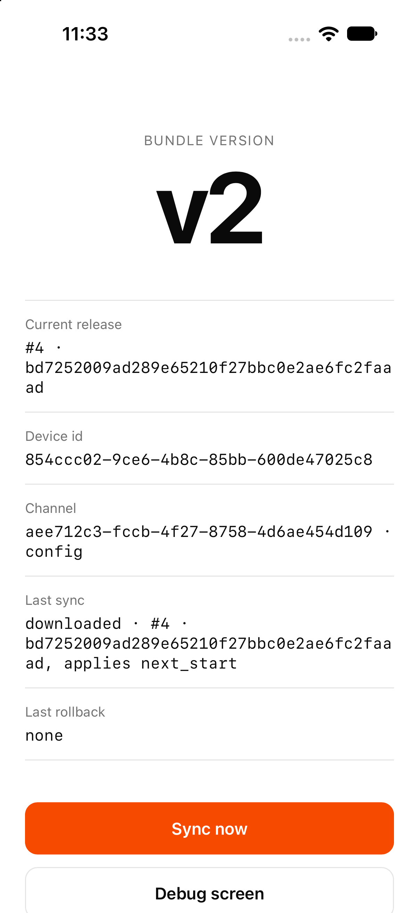

# Cordova code push demo by HotCodePush

[](https://github.com/hotcodepush-team/cordova-code-push-demo/actions/workflows/ci.yml)
[](https://github.com/hotcodepush-team/cordova-code-push-demo/actions/workflows/release.yml)

A Cordova app with [`@hotcodepush/cordova-code-push`](https://github.com/hotcodepush-team/cordova-code-push) added, the way `npx hotcodepush init` adds it. It is pre-configured for a HotCodePush app on production. Install the download, open it and watch the first over-the-air (OTA) update land. No account, no setup. Every merge to `main` ships a release to that app through the [GitHub Action](https://github.com/hotcodepush-team/release-action), and CI builds both platforms.

<p align="center">
  
</p>

## Download

The [downloads release](https://github.com/hotcodepush-team/cordova-code-push-demo/releases/tag/downloads) carries the app for Android and for the iOS simulator. Every merge to `main` rebuilds both, with the label `v1`, before it ships the update.

```sh
# Android, on a device or an emulator
adb install hotcodepush-demo-cordova-android.apk

# iOS simulator, booted from Xcode
unzip hotcodepush-demo-cordova-ios-simulator.zip
xcrun simctl install booted "HotCodePush Demo.app"
```

The app starts on `v1` and downloads `v2` on its first sync, the release `main` shipped after the build. Open it again and the badge reads `v2`.

## What you will see

- 🏷️ **A version badge** that changes without a store build, `v1` from the embedded bundle, then the label of the newest release.
- 🔄 **Sync now**, one call to `sync()`, with the last result and the last rollback on screen.
- 🛟 **Automatic rollback**: a release whose bundle never renders is rolled back on the next start, and the screen says so.
- 🔍 **The debug screen**, the SDK's own view of the device, the channel and the last check, one tap away.
- 🚀 **The release workflow**, `.github/workflows/release.yml`, the GitHub Action releasing the web build on every merge.

## Tech stack

cordova-ios 8 and cordova-android 15, Vite and TypeScript without a frontend framework, the HotCodePush Cordova SDK, Maestro for the device flows.

## Getting started

### Prerequisites

Node 24, as `.nvmrc` names it, and Xcode or Android Studio. A HotCodePush account is not needed to run the demo.

### Run it

```sh
nvm use
npm ci
npm run build
npx cordova prepare
npx cordova run ios
```

Or `npx cordova run android`. `prepare` restores the platforms and the plugin from `package.json` and copies the web build into each platform. The app starts on its embedded bundle and syncs against the `production` channel of the demo's app. A build takes only releases created after it was built, so a fresh build answers `skipped · release_older_than_binary` until the next merge to `main` ships a release. That is what the download is for.

### Ship an update of your own

Point the demo at an app of yours and release from your machine:

```sh
npx hotcodepush init
npm run build && npx hotcodepush release create
```

`init` signs you in and rewrites `hotcodepush.json` with your app. Change `VERSION` in `src/main.ts` before the release, rebuild once so the store build registers itself, then reopen the app to see the new label.

## Continuous integration

`release.yml` runs on every merge to `main` and releases the web build to the demo's app:

```yaml
- uses: hotcodepush-team/release-action@v0.3.0
  with:
    token: ${{ secrets.HOTCODEPUSH_TOKEN }}
    bundle-version: ${{ github.sha }}
```

`ci.yml` builds the app on both platforms with the plugin the repo pins and runs the Maestro flows in `maestro/` on the simulator and the emulator.

## Development

```sh
npm run dev              # Vite in the browser, where no plugin exists
npm run build            # the web bundle into www/
npm run prepare:native   # cordova prepare
npm run lint && npm run typecheck
npm run fmt              # run before every commit
```

`CLAUDE.md` holds the native build commands, the resource file's rules, the Maestro flows and the environment variables that point a build at a local stack.

## Documentation

See [hotcodepush.com/docs/sdks/cordova](https://hotcodepush.com/docs/sdks/cordova).

## License

See [LICENSE](./LICENSE).
